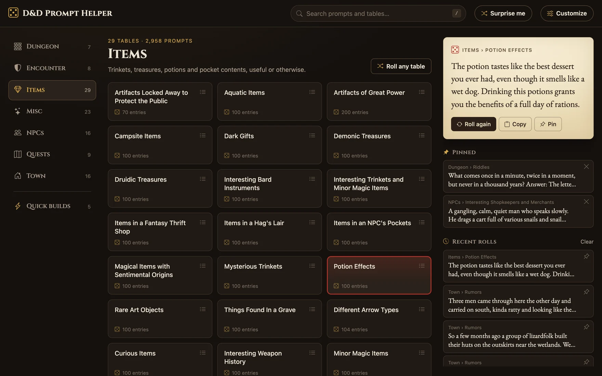
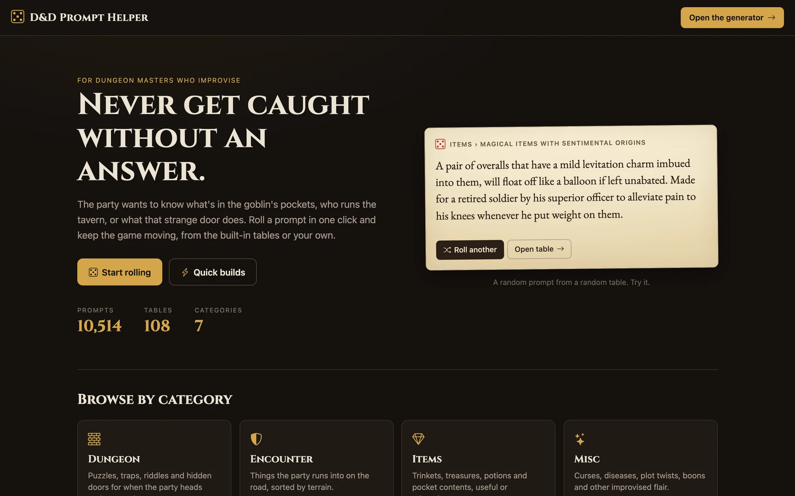
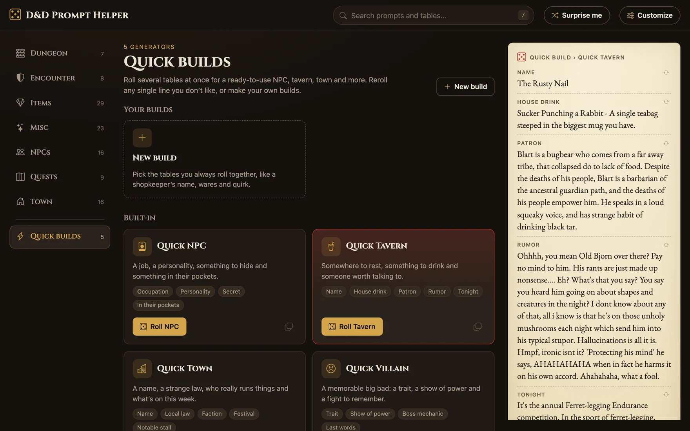
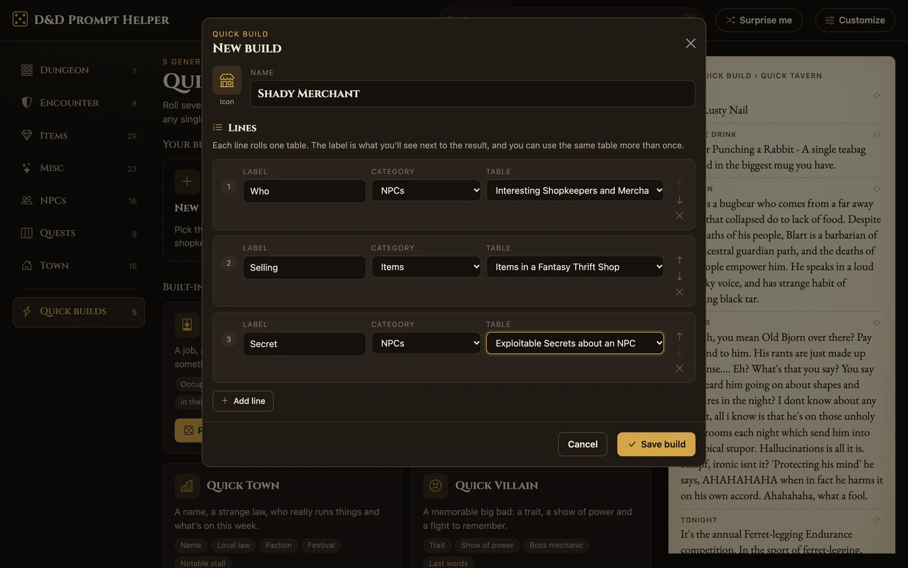
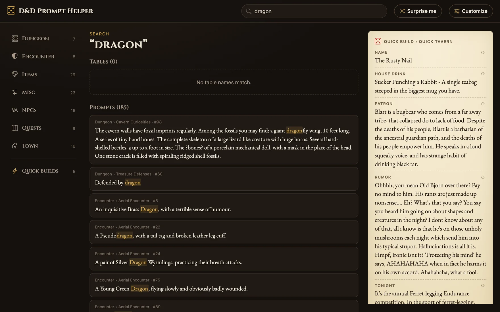
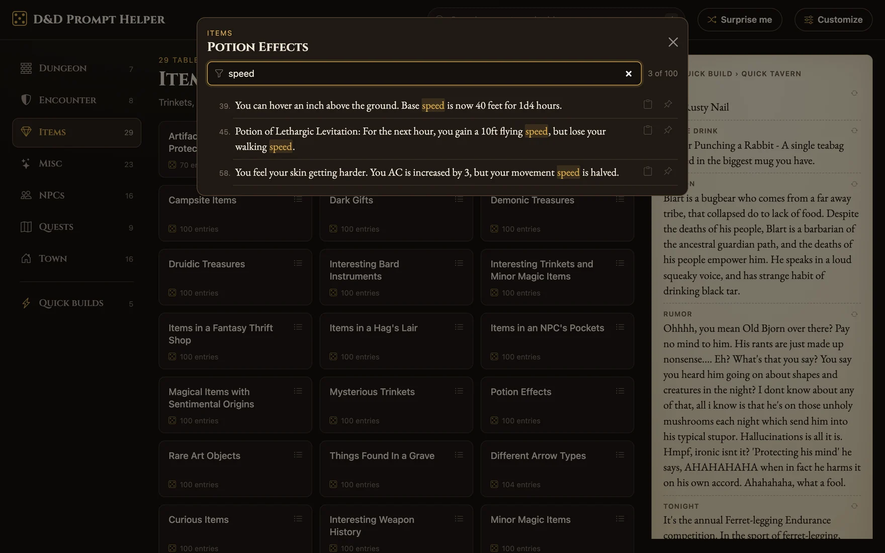
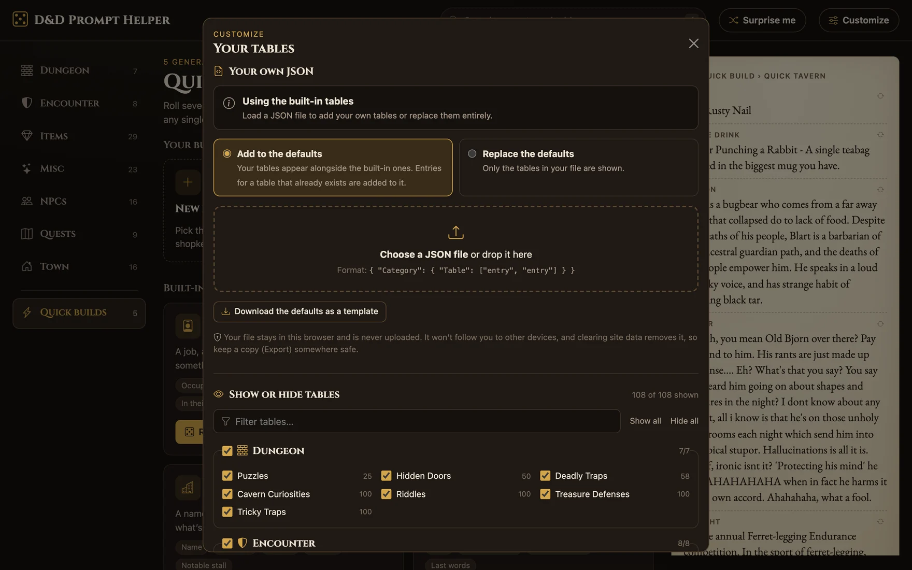
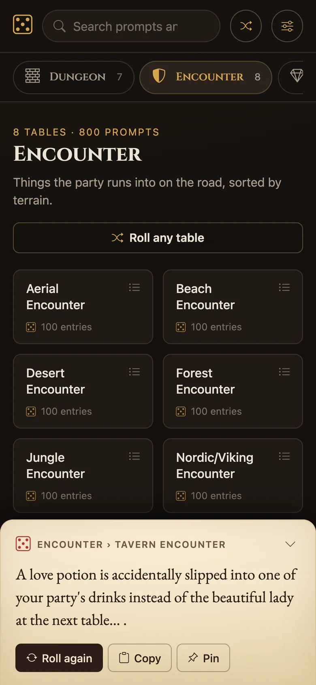

<div align="center">


# D&D Prompt Helper

**Never get caught without an answer.**
Random prompts for dungeon masters: encounters, NPCs, items, quests, towns and more, one click away.

[**Open the live app →**](https://dnd-generator-pythonflask.onrender.com/)


[](https://github.com/EonViljoen/Dnd-Generator-PythonFlask/actions/workflows/checks.yml)

<br><br>



</div>

---

## Contents

- [Features](#features)
- [Screenshots](#screenshots)
- [Tech stack and tools](#tech-stack-and-tools)
- [Getting started](#getting-started)
- [Tests](#tests)
- [Project structure](#project-structure)
- [The prompt data](#the-prompt-data)
- [Your own tables and builds](#your-own-tables-and-builds)
- [API](#api)
- [Deployment](#deployment)
- [Roadmap](#roadmap)

## Features

**10,414 prompts** across **108 tables** in **7 categories**, from riddles and deadly traps to tavern names and an ogre's pocket contents.

| | |
|---|---|
| 🎲 **One-click rolls** | Pick a table and roll. The result appears on a parchment panel with **Roll again**, **Copy** and **Pin**. |
| ⚡ **Quick builds** | Roll several tables at once: a Quick NPC, Tavern, Town, Villain or Side Quest. Reroll any single line you don't like. |
| 🛠️ **Your own builds** | Create Quick builds from any tables: name each line, pick an icon, reorder lines, or copy a built-in build as a starting point. |
| 🎯 **Dice roller** | d4 to d100 with a count, modifier and advantage/disadvantage, or type any notation (`2d6+3`, `4d6kh3`, `1d20+1d4`). Save named rolls like *Longsword attack* to reuse in one click. Dice written inside prompts ("lasts *1d4* hours", "*2d4×100* gp") are clickable too. Shows every die, highlights natural 20s and 1s, and uses fair cryptographic randomness. |
| 🧝 **Characters** | Keep each player's character on a simple sheet: race, class, level, HP, AC, speed, ability scores (modifiers, proficiency, initiative and passive Perception worked out for you), armor, weapons, inventory, coins and notes. Quick damage/heal and a Level up button on every card. |
| 🛡️ **Parties** | Group characters into named parties, one per campaign or table. Switch off anyone who isn't playing this session, see the party at a glance, and level everyone up at once. |
| ⚔️ **Initiative tracker** | Add your party and monsters (numbered automatically, initiative rolled for you), then step through turns and rounds. Track HP with quick damage/heal, AC and conditions. Defeated monsters are skipped, and it all survives a refresh. |
| 🔁 **Roll several, no repeats** | Roll ×2, ×3 or ×5 different prompts at once, each with its own reroll. Turn on *Don't repeat prompts* and every table hands out each entry once before reshuffling; tiles show how many are left. |
| 🔀 **Surprise me** | Roll on a random table, or on any table within the current category. |
| 🔍 **Search** | Search every table name and all 10k+ prompts, with highlighted matches. |
| 📜 **Browse tables** | View any table as a numbered, filterable list, and copy or pin individual entries. |
| 📌 **Pins and history** | Keep the prompts you'll use tonight. Your last 10 rolls are always one click away. |
| ✏️ **Edit tables** | Add, edit and delete entries right in a table's list (with Undo), create tables and categories, and rename or move your own tables and categories (your builds, hidden tables and icons follow along). Editing a built-in table makes a personal copy in your browser (other users still see the original), with *Reset to original* at any time, or duplicate it as your own table. |
| 🎛️ **Customize** | Hide tables you don't use, or load your own JSON, added to the defaults or replacing them, with a custom icon per category. |
| 🔗 **Share by link** | Share a result, a custom Quick build or a saved roll with a link. The data lives in the link itself (after the `#`, which never reaches the server); opening it shows the result or offers to add the build/roll. Shared dice show the exact same roll. |
| 🎨 **Themes** | Five presets (Tavern, Arcane, Forest, Frost and the light Parchment), or build your own from 7 colours with a live preview and a readability check. Saved in your browser and applied before the page draws. |
| 🔒 **Private by design** | Custom tables, builds, pins and history stay in your browser. Nothing is uploaded and there are no accounts. |
| 📱 **Works anywhere** | Responsive layout: sidebar on desktop, scrolling category chips and a bottom result sheet on phones. |
| 💾 **Backup file** | Download everything you've set up (your tables and edits, Quick builds, saved rolls, characters and parties, initiative tracker, theme and settings) as one file, then restore it on another device, choosing which parts to bring over. No accounts: it stays yours. |
| 📲 **Offline & installable** | Install it as an app (its own window, home-screen icon). Optionally save the built-in tables (about 2 MB, only after you agree) so everything works without internet and opens instantly, even while Render's server is waking up. Saved tables update themselves when the prompts change. |

### Keyboard shortcuts

| Key | Action |
|-----|--------|
| <kbd>/</kbd> | Focus search |
| <kbd>R</kbd> | Roll the last table, build or dice again |
| <kbd>S</kbd> | Surprise me (roll on a random table) |
| <kbd>N</kbd> | Next turn (Initiative tracker) |
| <kbd>Esc</kbd> | Clear search or close a dialog |

## Screenshots

<table>
  <tr>
    <td width="50%">
      
      <p align="center"><b>Homepage</b>: a live random prompt and every category at a glance</p>
    </td>
    <td width="50%">
      
      <p align="center"><b>Quick builds</b>: roll a whole tavern, reroll any line</p>
    </td>
  </tr>
  <tr>
    <td width="50%">
      
      <p align="center"><b>Build editor</b>: make your own builds from any tables</p>
    </td>
    <td width="50%">
      
      <p align="center"><b>Search</b>: every table and all 10k+ prompts</p>
    </td>
  </tr>
  <tr>
    <td width="50%">
      
      <p align="center"><b>Browse a table</b>: filter, copy or pin any entry</p>
    </td>
    <td width="50%">
      
      <p align="center"><b>Customize</b>: your own JSON, kept in your browser</p>
    </td>
  </tr>
</table>

<p align="center">
  
  <br>
  <b>On your phone</b>: category chips and a bottom result sheet
</p>

## Tech stack and tools

### Backend

| Tool | Used for |
|------|----------|
| [Python 3.11](https://www.python.org/) | Language (pinned in [`.python-version`](.python-version), which Render follows) |
| [Flask 3](https://flask.palletsprojects.com/) | Web framework, routing and blueprints |
| [Flask-RESTful](https://flask-restful.readthedocs.io/) | JSON API resources under `/api` |
| [Jinja2](https://jinja.palletsprojects.com/) | Server-rendered templates (shared `base.html`, homepage stats and cards) |
| [Gunicorn](https://gunicorn.org/) | Production WSGI server |

### Frontend

| Tool | Used for |
|------|----------|
| Vanilla JavaScript (ES modules) | All UI logic, with no framework or build step (`app.js`, `data.js`) |
| [IndexedDB](https://developer.mozilla.org/docs/Web/API/IndexedDB_API) | Stores custom JSON tables, custom Quick builds, saved dice rolls, characters and parties in the browser |
| [localStorage](https://developer.mozilla.org/docs/Web/API/Window/localStorage) | Pins, roll history, hidden tables, dice settings, the initiative tracker, your theme, and roll options (×N, seen entries for no repeats) |
| [Web Crypto](https://developer.mozilla.org/docs/Web/API/Crypto/getRandomValues) | Unbiased dice rolls (`crypto.getRandomValues` with rejection sampling) |
| [Bootstrap 5.3](https://getbootstrap.com/) | Modals and base styles (self-hosted in `static/vendor`) |
| [Bootstrap Icons 1.11](https://icons.getbootstrap.com/) | Every icon in the app, including the category and build icon picker (self-hosted) |
| [Cinzel and EB Garamond](https://fonts.google.com/) | Headings and prompt text (self-hosted, latin subset, SIL Open Font License) |
| [Service worker](https://developer.mozilla.org/docs/Web/API/Service_Worker_API) and [web app manifest](https://developer.mozilla.org/docs/Web/Manifest) | Offline pages and files, installable app |
| Custom CSS | Themes built on CSS custom properties: 7 base colours per theme, every other shade derived with `color-mix()` |

### Hosting and tooling

| Tool | Used for |
|------|----------|
| [Render](https://render.com/) | Hosting, with automatic deploys on push to `main` |
| [Git](https://git-scm.com/) and [GitHub](https://github.com/EonViljoen/Dnd-Generator-PythonFlask) | Version control |
| [Claude Code](https://claude.com/claude-code) | AI pair programmer used for the UI redesign and newer features |

## Getting started

**Requirements:** [Python 3.11](https://www.python.org/downloads/) (newer works too; macOS: `brew install python@3.11`)

```bash
git clone https://github.com/EonViljoen/Dnd-Generator-PythonFlask.git
cd Dnd-Generator-PythonFlask
python3.11 -m venv venv
```

Activate the virtual environment and install dependencies:

<table>
<tr><th>macOS / Linux</th><th>Windows (PowerShell)</th></tr>
<tr>
<td>

```bash
source venv/bin/activate
pip install -r requirements.txt
```

</td>
<td>

```powershell
.\venv\Scripts\activate
pip install -r .\requirements.txt
```

</td>
</tr>
</table>

Run the development server:

```bash
flask --app main run --debug --port 5001
```

Then open <http://localhost:5001>. The generator is at `/cards`.

> [!TIP]
> On macOS, port 5000 (Flask's default) is usually taken by AirPlay Receiver, hence `--port 5001`. `python main.py` also works and uses port 5000.

Run `deactivate` to leave the virtual environment.

## Tests

Every push runs the automated checks on GitHub ([`.github/workflows/checks.yml`](.github/workflows/checks.yml)):

| Check | What it covers |
|-------|----------------|
| **Python** (3.11 and 3.13) | Clean install and `pip check`; every page and API route, including 404s for bad names; data checks on `rpg_generator.json` (no empty entries, no `?` encoding glitches, no split entries, valid names, Quick builds point at real tables); the app starting under Gunicorn and passing `/api/health` |
| **JavaScript** | Syntax check of every script; unit tests for the dice engine, initiative tracker, table editing, characters and parties, and backups |

Run them locally:

```bash
pip install -r requirements-dev.txt
pytest
node --test tests/*.test.mjs
```

## Project structure

```text
├── main.py               # App setup: Flask app, blueprints, JSON settings
├── main_blueprint.py     # Pages: / (home), /cards (generator), /favicon.ico
├── api_blueprint.py      # API route registration (/api/...)
├── routes.py             # API resources (Flask-RESTful)
├── jsonReader.py         # Loads rpg_generator.json; roll, search, structure, combos
├── catalog.py            # Category icons and blurbs, built-in Quick build recipes
├── rpg_generator.json    # The prompt data
├── templates/
│   ├── base.html         # Shared <head>, fonts and header
│   ├── index.html        # Homepage
│   └── card.html         # Generator page and its modals
├── static/
│   ├── scripts/
│   │   ├── theme.js      # Theme presets/custom colours, applied in <head> before first paint
│   │   ├── app.js        # Generator UI (ES module)
│   │   ├── data.js       # Data layer: server/local sources, IndexedDB, validation
│   │   ├── dice.js       # Dice notation parser and fair roller (no DOM, testable in Node)
│   │   ├── initiative.js # Initiative tracker state: order, turns, HP, conditions (no DOM)
│   │   ├── party.js      # Characters and parties: sheet rules, levels, HP, groups (no DOM)
│   │   ├── edits.js      # Table editing and personal copies (no DOM)
│   │   └── backup.js     # Backup file: make and check it (no DOM)
│   ├── sw.js             # Service worker: pages and files work offline / during cold starts
│   ├── manifest.webmanifest  # Installable app: name, icons, shortcuts
│   ├── vendor/           # Self-hosted Bootstrap, Bootstrap Icons and fonts (with licences)
│   ├── styles/style.css  # Theme and layout
│   └── images/           # Favicon (SVG, ICO), Apple touch icon, app icons (192, 512, maskable)
├── tests/                # pytest (pages, API, data) and Node tests (dice, initiative, editing, party, backup)
├── .github/workflows/    # Automated checks on every push
├── docs/screenshots/      # README screenshots
├── procfile              # Gunicorn start command
└── .render.yaml          # Render service config
```

## The prompt data

All built-in prompts live in [`rpg_generator.json`](rpg_generator.json):

```json
{
  "Category": {
    "Table": [
      "Entry 1",
      "Entry 2"
    ]
  }
}
```

To add prompts, add entries to an existing table, or add a new table or category anywhere in the file. New categories get a default icon; add an icon and blurb for them in [`catalog.py`](catalog.py).

| Category | Tables | Prompts | About |
|----------|-------:|--------:|-------|
| 🧱 Dungeon | 7 | 533 | Puzzles, traps, riddles and hidden doors for when the party heads underground. |
| 🛡️ Encounter | 8 | 800 | Things the party runs into on the road, sorted by terrain. |
| 💎 Items | 29 | 2,858 | Trinkets, treasures, potions and pocket contents, useful or otherwise. |
| ✨ Misc | 23 | 2,298 | Curses, diseases, plot twists, boons and other improvised flair. |
| 👥 NPCs | 16 | 1,525 | "Who's that?" Shopkeepers, villains, familiars and their secrets. |
| 🗺️ Quests | 9 | 895 | Hooks, side quests and travel events for when the party goes off-script. |
| 🏠 Town | 16 | 1,505 | Taverns, laws, festivals and factions to make a settlement feel lived-in. |

## Your own tables and builds

Everything below is stored **only in the user's browser**. The server never sees it, and there are no accounts.

**Customize** (button in the generator's header):

- **Show or hide tables** individually or by category. Hidden tables also drop out of search, Surprise me and Quick builds. *(localStorage)*
- **Load your own JSON** in the format above. Choose **Add to the defaults** (new tables are added, and entries for an existing table are appended without duplicates) or **Replace the defaults**. Files are validated in the browser with readable error messages. *(IndexedDB)*
- **Pick an icon** for each category in your file.
- **Download the defaults as a template**, **Export** your file, or **Remove** it.

While custom data is active, rolling, searching and Quick builds run entirely in the browser.

**Custom Quick builds** (from the Quick builds view): name it, pick an icon, and add up to 12 lines, each a label plus a category and table. They're stored in IndexedDB using the same line shape as the built-in builds:

```json
[
  {
    "id": "u-mw3c0mv0f4yg8",
    "title": "Tavern Regular",
    "icon": "cup-straw",
    "parts": [
      { "label": "Job",   "category": "NPCs", "sub": "Occupations" },
      { "label": "Quirk", "category": "NPCs", "sub": "Personality Traits" }
    ]
  }
]
```

**Saved dice rolls** (Tools › Dice) are stored in IndexedDB too, as `[{ id, name, notation, mode }]` where `mode` is `normal`, `adv` or `dis`.

> [!NOTE]
> Browser storage doesn't sync between devices and is cleared along with the site's data. Use **Export** to keep a copy of your custom tables.

## API

All endpoints are `GET` and return JSON.

| Endpoint | Returns |
|----------|---------|
| `/api/health` | `{status: "ok", categories, tables, prompts, commit, python, data_version}`, a quick check for monitors and Render (`commit` is the deployed Git commit on Render, `python` the server's Python version, `data_version` a hash of the prompt data) |
| `/api/bundle` | `{version, structure, combos, data}`: everything needed to work offline, in one download (used only after the user agrees to save the tables) |
| `/api/structure` | Categories with icon, blurb, totals and tables (no entry text) |
| `/api/random` | A random entry from a random table: `{category, sub, text}`. Optional `?category=` |
| `/api/r/<category>?arg=<table>` | A random entry from one table |
| `/api/<category>?arg=<table>` | Every entry in a table (add `&id=<n>` for one entry) |
| `/api/search?q=<text>&limit=<n>` | Matching entries: `{total, results: [{category, sub, index, text}]}` (limit up to 200) |
| `/api/combos` | Built-in Quick build recipes |
| `/api/combos/<id>` | A rolled Quick build |
| `/api/getall` | The full dataset, in file order (also used as the upload template) |
| `/api/Headings`, `/api/SubHeadings?category=`, `/api/EntryCount` | Legacy helpers kept for compatibility |

Unknown categories, tables or ids return `404`.

## Deployment

The app is deployed on [Render](https://render.com/) and redeploys automatically on every push to `main`:

- **Build:** `pip install -r requirements.txt`
- **Start:** `gunicorn main:app` (see [`procfile`](procfile) and [`.render.yaml`](.render.yaml))

Recommended Render settings (service → **Settings**):
- **Auto-Deploy: After CI Checks Pass**, so a push that fails the checks never goes live and the last good version keeps running.
- **Health Checks → path `/api/health`**, so Render only switches traffic to a new deploy once it answers, and restarts an instance that stops responding.

**Cold starts:** Render's free tier puts the server to sleep when idle, and waking it can take up to a minute. A service worker ([`static/sw.js`](static/sw.js)) keeps a copy of the pages and their files, so returning visitors get the page straight away. Visitors who chose to save the tables start instantly from that copy and the app checks for updates in the background; everyone else sees a *"Waking up the tavern…"* screen that retries until the API answers. A visitor's very first visit still waits for the server.

## Roadmap

- [x] Homepage
- [x] Redesigned generator: categories, search, pins and history
- [x] Quick builds, plus your own custom builds
- [x] Custom JSON tables and show/hide, kept in the browser
- [x] Dice roller tool
- [x] Initiative tracker
- [x] Characters and parties (step 1: the basic sheet)
- [x] Edit tables directly in the browser (entries, new tables, personal copies)
- [x] Rename and move tables, create and rename categories
- [x] Works offline (opt-in) and installs as an app
- [x] Move everything to another device with a backup file (no accounts, by design)
